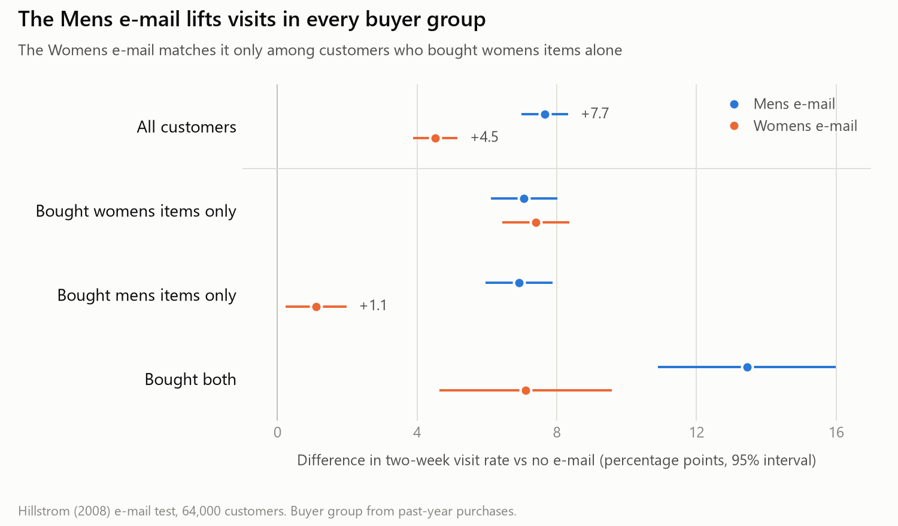

# Hillstrom e-mail A/B test readout

This repository analyzes a randomized e-mail test on 64,000 customers (Hillstrom, 2008) from design to recommendation: which campaign to send, to whom, and with what uncertainty.

The analysis recommends sending the Mens e-mail to every customer. It increased the two-week visit rate by 7.7 percentage points against no e-mail and was effective in every buyer group, and model-based targeting did not improve on it. The one-page readout is [docs/readout.md](docs/readout.md).

<picture>
  <source media="(prefers-color-scheme: dark)" srcset="figures/visit_lift_dark.png">
  
</picture>

## Prior analyses

These data are a standard example for uplift modeling, and their main results have been reported before.

| Source | What it does |
| --- | --- |
| [Radcliffe, Stochastic Solutions (2008)](https://www.stochasticsolutions.com/pdf/HillstromChallenge.pdf), the winning entry of the original challenge | Compares the campaigns on visits, purchases and spend, checks the random allocation through covariate proportions, and fits bagged-tree uplift models judged by Qini graphs |
| [TensorFlow Decision Forests tutorial](https://www.tensorflow.org/decision_forests/tutorials/uplift_colab) | Merges the two e-mails into one treatment and fits an uplift random forest for conversion, scored by AUUC and Qini |
| [aimz example](https://aimz.readthedocs.io/stable/examples/hillstrom.html) | A Bayesian logistic model for conversion and a hurdle model for spend, with posterior intervals for each campaign against control and a covariate balance table |

The unadjusted differences against control in this project match Table 2 of the winning entry: visit rate +7.66 points (Mens) and +4.52 points (Womens), conversion +0.68 and +0.31 points, and spend per customer $0.77 and $0.42. As in that entry, the Mens e-mail outperforms the Womens e-mail on all three measures, and the uplift model here uses a setup that all three sources use.

The project adds the following steps of a standard experiment readout, which were not found in the three sources:

- A design document with metrics, tests and a decision rule, committed before any outcome was computed, with later clarifications dated.
- A chi-square sample ratio test next to the covariate balance check.
- Holm-corrected tests and 95% intervals for all three pairwise comparisons, including Mens vs Womens.
- Spend per visitor as a ratio metric, with delta-method errors checked by a bootstrap.
- CUPED and regression adjustment with the variance reduction measured, which is at most 2.9% here, as the pre-period covariates are weakly related to two-week outcomes.
- Pre-specified subgroup tests with Holm correction, in which only past-year buyer type changes the effect.
- The value of a targeting policy, estimated on held-out customers by inverse probability weighting and compared with sending one e-mail to all.

## Run

```
python -m venv .venv
.venv\Scripts\activate            # Windows (macOS or Linux: source .venv/bin/activate)
pip install -e ".[dev,figures]"
python scripts/download_data.py
pytest
python -m hillstrom_ab.build data/hillstrom.csv results/checks --checks-only
python -m hillstrom_ab.build data/hillstrom.csv results/metrics
python -m hillstrom_ab.effects data/hillstrom.csv results/effects
python -m hillstrom_ab.targeting data/hillstrom.csv results/targeting
python scripts/key_figure.py results figures
```

The first `build` writes only the data checks, the sample ratio test and covariate balance. The second adds the outcome metrics by arm. `effects` writes the between-arm estimates and applies the decision rule. `targeting` runs the subgroup tests, the uplift model and the held-out policy values.

## Layout

| Path | Contents |
| --- | --- |
| `docs/design.md` | Experiment design, written before any outcome was computed |
| `docs/readout.md` | One-page readout with the recommendation |
| `src/hillstrom_ab/sql/` | Metric definitions and checks |
| `src/hillstrom_ab/metrics.py` | DuckDB connection and standard errors |
| `src/hillstrom_ab/effects.py` | Between-arm effects, covariate adjustment, bootstrap, decision rule |
| `src/hillstrom_ab/subgroups.py`, `uplift.py` | Subgroup tests, uplift model, Qini curves, policy values |
| `scripts/` | Data download, power table, key figure |
| `results/`, `figures/` | Output tables and figures |

## Data and license

The data come from Kevin Hillstrom's [MineThatData E-Mail Analytics and Data Mining Challenge](https://blog.minethatdata.com/2008/03/minethatdata-e-mail-analytics-and-data.html) (2008). They are not included in this repository, and `scripts/download_data.py` fetches them from the original challenge page. The test fixture in `tests/fixtures/` is synthetic.

The code is released under the MIT License (see [LICENSE](LICENSE)). The data remain with their original provider.
